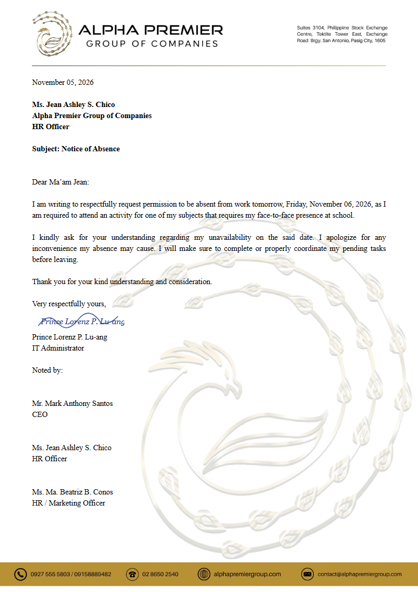

# APG Excuse Letters

Alpha Premier Group's leave-of-absence letters for interns and employees, as a **Windows desktop app**. Interns fill in a form with no account; employees sign in. Either files a letter (alone or as a group), signs it, and sends it to HR. HR signs in as admin and reviews the letter beside the rendered A4 page. HR can comment on words in the letter, then approve, return or decline it. Approved letters get a reference number and HR's signature, and print or save as PDF.

It is built on the same stack and layout as **APG Post-It**, so the two apps can be joined later.

| | |
| --- | --- |
| Desktop shell | Tauri 2 (Rust), WebView2 |
| Screens | React 18 + TypeScript (strict), Vite 5, React Router (hash routes) |
| Data | SQLite in the app (rusqlite, bundled), saved by Rust |
| Tests | Vitest (rules), `cargo test` (storage) |
| Design | Post-It's design system: `src/theme/tokens.css`, Montserrat, gold accents, dark by default |



### The letter

The 2026 "Notice of Absence" format on the new letterhead, in two versions. The intern form always makes the intern letter, and a signed-in employee always gets the employee letter:

| | Intern | Employee |
| --- | --- | --- |
| Greeting | Good day, | Dear Ma'am Jean: |
| First paragraph | "I am respectfully requesting permission to take a leave of absence on [date] as [reason]" | "I am writing to respectfully request permission to be absent from work [tomorrow,] [date], as [reason]" |
| Closing | Respectfully, (name only) | Very respectfully yours, (name and position) |
| Noted by | HR Officer | CEO, HR Officer, HR / Marketing Officer |

The member's reason finishes the first sentence ("…on Tuesday, October 27, 2026 as I have a meeting…"). The wording is fixed. In **Settings → Letter**, HR changes only who the letter is addressed to and who is listed under "Noted by". HR signs in the app: the approval signature goes above the HR officer's name. On the employee letter, the CEO and the HR / Marketing Officer sign the printed copy by hand. A very long letter shrinks its type slightly so it always fits one page.

### HR's comments

Comments work like Google Docs comments. While a letter waits for review, HR selects words on the letter and comments on them. The words are highlighted, with the comment beside them. New comments stay private until HR returns (or declines) the letter. Then the member sees the same highlights and fixes the letter. If the member rewrites the commented words, the comment says so. HR resolves each comment, or all at once, before approving. Highlights never print.

## Run it

You need **Node.js 20+**, and for the desktop app **Rust** (stable, MSVC toolchain) with the Microsoft C++ build tools and WebView2 (already on Windows 11). See <https://tauri.app/start/prerequisites/>.

```bash
npm install
```

| Command | What it does |
| --- | --- |
| `npm run tauri dev` | Opens the desktop app with live reload. The first run compiles Rust and takes a few minutes. |
| `npm run tauri build` | Builds the installer (`src-tauri/target/release/bundle/`). |
| `npm run dev` | Runs the screens in a normal browser at <http://localhost:1421>, with the data in `localStorage` instead of SQLite. Handy for UI work without Rust. |
| `npm test` | Rule tests (filing, letter codes, groups, duplicate guard, editing, comments, sign-in, HR decisions). |
| `cd src-tauri && cargo test` | Storage tests (SQLite save, load, reset). |
| `npm run build` | Type-checks and builds the screens into `dist/`. |

### Signing in

The home screen has three ways in:

| Who | How |
| --- | --- |
| Interns | No account. **Intern absence form**: type your name and department, fill in the absence, sign, send. You get a 6-character **letter code** (like `K7Q-4MZ`). Enter it on the home screen to see the status and HR's comments, revise a returned letter, withdraw a waiting one, or print the approved one. Anyone with the code can open the letter, so keep it private. |
| Employees | **Employee sign-in**, or create an account. Your position and department are typed on each letter; the next one starts from your last. |
| HR | **HR sign-in** (admin). |

The first run loads the sample data from `src/core/seed.json`. The temporary HR and employee logins are in [`src/config.ts`](src/config.ts) (`TEMP_ACCOUNTS`). Sample intern letter codes: `K7Q-4MZ` (returned with comments), `D8M-3JR` (waiting for HR). While `SHOW_TEST_BAR` is `true`, a bar at the top switches between people (or the intern form) in one click and has **Reset sample data**. Set it to `false` before handing the app out.

### Where the data lives

`%LOCALAPPDATA%\com.alphapremier.apgexcuseletters\excuse-letters.db` (one SQLite file). Delete it, or use **Reset sample data**, to start over. CSV exports go to `Downloads\APG Excuse Letters`.

## What it does

| Who | What |
| --- | --- |
| Intern (no account) | File a full-day, half-day or several-day request; sign digitally (draw or upload) or by hand (upload a photo, or hand the paper to HR). With the letter code: see HR's comments, revise a returned letter or one still waiting, withdraw a waiting one, print an approved one. No drafts. |
| Employee | The same, plus drafts, **My requests**, a saved signature, and the calendar. |
| Group (same reason) | **Who is absent? → Group (same reason)**, up to 6 people. Interns type each person's name and department. Employees pick colleagues with an account or type a name and position. Each person signs (digital) or everyone signs the paper (wet). The letter switches to "We … our" wording. A listed employee with an account sees it in **My requests** (view only). |
| HR | Review queue (waiting first, filters, CSV export); review screen with the letter, comments on its words, signature check against earlier signatures, paper-copy tracking, approve / return / decline with remarks, history; calendar; settings for the addressee, the "Noted by" lines and the approval signature. |
| Everyone signed in | Calendar of approved and waiting absences. Employees can open only their own letters from it. |

Rules that hold everywhere: no one can be booked twice for the same half-day (also across group letters); dates can't be more than 7 days back; the reason is 30–400 characters; approval needs the paper copy first for hand-in letters, and every comment resolved; returning needs remarks or a comment; returned and declined letters free their dates.

## How the code is laid out

Same structure as APG Post-It:

```
src/
  core/        Rules as plain functions: (data, input) → changes to save, or why not. No React, no Tauri.
  platform/    The only way out to the OS: tauri.ts (SQLite through Rust), browser.ts (dev), memory.ts (tests).
  theme/       Design tokens and base styles, copied from Post-It.
  ui/          React: components/ (Post-It's), letter/ (the A4 letter and printing), screens/, state/.
src-tauri/
  src/db.rs    SQLite: load, commit a batch of changes in one transaction, reset.
  src/files.rs Saves CSV exports inside Downloads\APG Excuse Letters only.
  capabilities/ What the screens are allowed to call.
```

Every action is a function in `src/core` that returns a `Changes` batch; `AppState.run()` hands it to the platform, which Rust commits in one SQLite transaction (like a Firestore batch). The data shape is the same as the old web app and `seed.json`, so it can move to Firestore later; `firestore.rules` is kept for that.

## What changed from the web version

The browser app (`app.js`, `styles.css`, `server.js`, `db.js`, `firebase-config.js`) was replaced by this desktop app. They are still in git history (commit `a15ace8` and earlier). The local Node SQLite server is no longer needed: the app keeps its own SQLite file. Multi-user sync across machines will come with a shared backend later.
