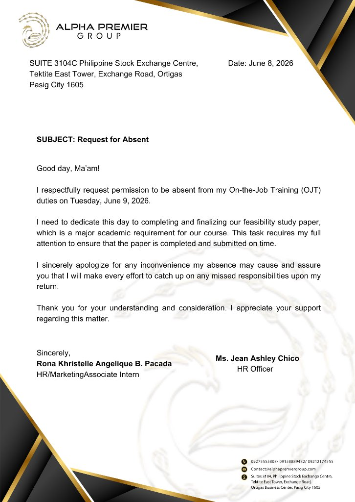

# APG Excuse Letters

Alpha Premier Group's leave-of-absence letters for interns and employees, as a **Windows desktop app**. Members file a letter (alone or as a group), sign it, and send it to HR; HR reviews it beside the rendered A4 letter and approves, returns or declines it. Approved letters get a reference number and HR's signature, and print or save as PDF.

It is built on the same stack and layout as **APG Post-It**, so the two apps can be joined later.

| | |
| --- | --- |
| Desktop shell | Tauri 2 (Rust), WebView2 |
| Screens | React 18 + TypeScript (strict), Vite 5, React Router (hash routes) |
| Data | SQLite in the app (rusqlite, bundled), saved by Rust |
| Tests | Vitest (rules), `cargo test` (storage) |
| Design | Post-It's design system: `src/theme/tokens.css`, Montserrat, gold accents, dark by default |



## Run it

You need **Node.js 20+**, and for the desktop app **Rust** (stable, MSVC toolchain) with the Microsoft C++ build tools and WebView2 (already on Windows 11). See <https://tauri.app/start/prerequisites/>.

```bash
npm install
```

| Command | What it does |
| --- | --- |
| `npm run tauri dev` | Opens the desktop app with live reload. The first run compiles Rust and takes a few minutes. |
| `npm run tauri build` | Builds the installer (`src-tauri/target/release/bundle/`). |
| `npm run dev` | Runs the screens in a normal browser at <http://localhost:1421>, with the data in `localStorage` instead of SQLite. Handy for UI work without Rust. |
| `npm test` | Rule tests (filing, groups, duplicate guard, editing, HR decisions). |
| `cd src-tauri && cargo test` | Storage tests (SQLite save, load, reset). |
| `npm run build` | Type-checks and builds the screens into `dist/`. |

### Signing in

The first run loads the sample data from `src/core/seed.json`. The temporary HR and member logins are in [`src/config.ts`](src/config.ts) (`TEMP_ACCOUNTS`). While `SHOW_TEST_BAR` is `true`, a bar at the top switches between people in one click and has **Reset sample data**. Set it to `false` before handing the app out.

### Where the data lives

`%LOCALAPPDATA%\com.alphapremier.apgexcuseletters\excuse-letters.db` (one SQLite file). Delete it, or use **Reset sample data**, to start over. CSV exports go to `Downloads\APG Excuse Letters`.

## What it does

| Who | What |
| --- | --- |
| Intern / employee | File a full-day, half-day or several-day request; sign digitally (draw or upload) or by hand (upload a photo, or hand the paper to HR); save a draft; edit a draft, a returned letter, or one still waiting for HR; withdraw a waiting one; print an approved one. |
| Group (same reason) | **New request → Who is absent? → Group (same reason)**. Add up to 6 people from the list, or type in someone with no account. Each person signs (digital) or everyone signs the paper (wet). The letter switches to "We … our" wording, and the request shows in every listed person's **My requests** (view only). |
| HR | Review queue (waiting first, filters, CSV export), review screen with the letter, signature check against earlier signatures, paper-copy tracking, approve / return / decline with remarks, history; calendar; settings for the letter wording, the approval signature and member profiles. |
| Everyone | Calendar of approved and waiting absences. Members can open only their own letters from it. |

Rules that hold everywhere: no one can be booked twice for the same half-day (also across group letters); dates can't be more than 7 days back; the reason is 30–400 characters; approval needs the paper copy first for hand-in letters; returned and declined letters free their dates.

## How the code is laid out

Same structure as APG Post-It:

```
src/
  core/        Rules as plain functions: (data, input) → changes to save, or why not. No React, no Tauri.
  platform/    The only way out to the OS: tauri.ts (SQLite through Rust), browser.ts (dev), memory.ts (tests).
  theme/       Design tokens and base styles, copied from Post-It.
  ui/          React: components/ (Post-It's), letter/ (the A4 letter and printing), screens/, state/.
src-tauri/
  src/db.rs    SQLite: load, commit a batch of changes in one transaction, reset.
  src/files.rs Saves CSV exports inside Downloads\APG Excuse Letters only.
  capabilities/ What the screens are allowed to call.
```

Every action is a function in `src/core` that returns a `Changes` batch; `AppState.run()` hands it to the platform, which Rust commits in one SQLite transaction (like a Firestore batch). The data shape is the same as the old web app and `seed.json`, so it can move to Firestore later; `firestore.rules` is kept for that.

## What changed from the web version

The browser app (`app.js`, `styles.css`, `server.js`, `db.js`, `firebase-config.js`) was replaced by this desktop app. They are still in git history (commit `a15ace8` and earlier). The local Node SQLite server is no longer needed: the app keeps its own SQLite file. Multi-user sync across machines will come with a shared backend later.
